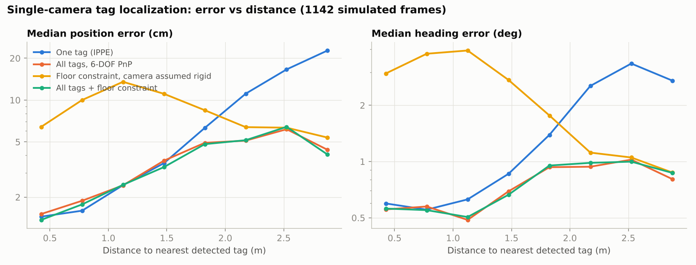
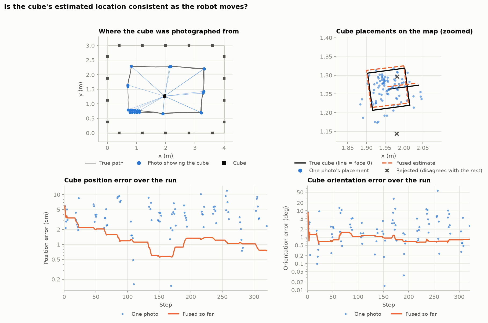
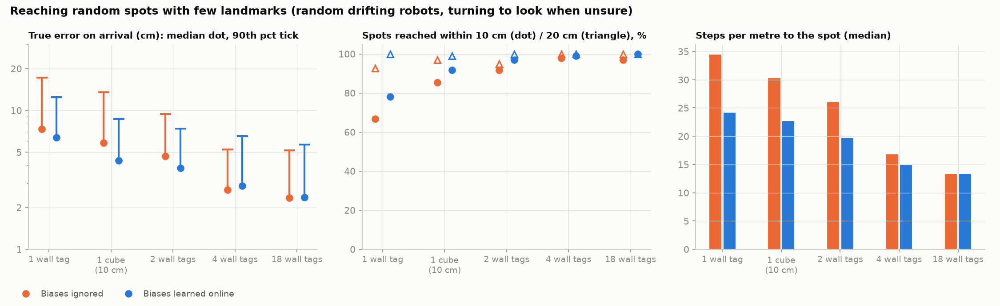
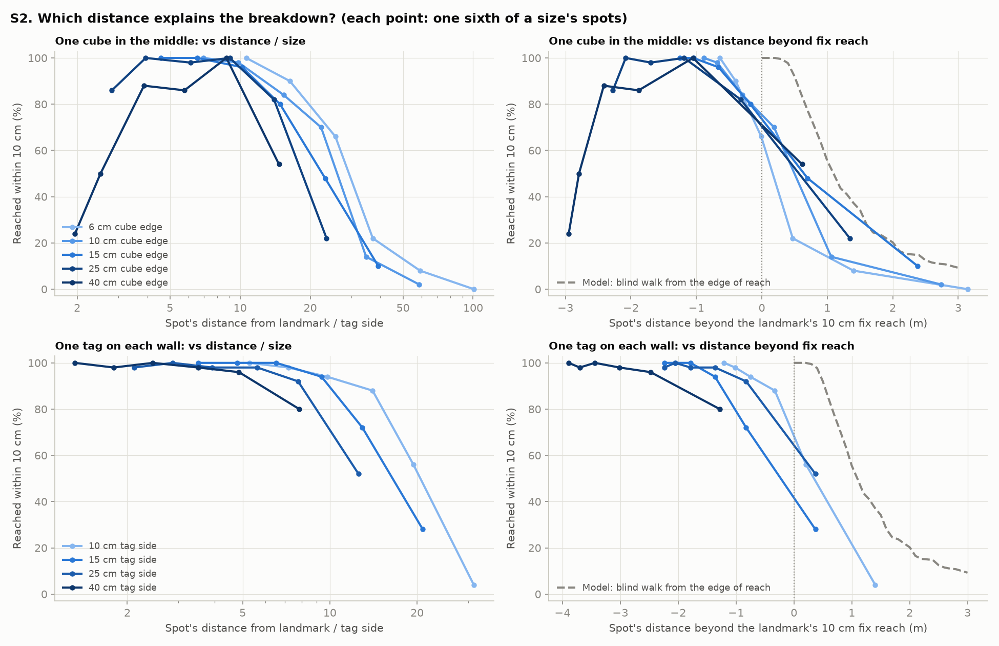

# tagsim

A synthetic test bench for localizing a small legged floor robot with a
single forward-facing camera and AprilTags.

It renders the image the robot's camera would see from a known pose, runs a
real tag detector (OpenCV ArUco, AprilTag 36h11) on it, estimates the
robot's pose exactly as the robot would, and compares the estimate with
ground truth. On top of that it simulates:

- **Locating an object:** a cube with a tag on each face, whose position and
  orientation the robot works out from its camera.
- **Navigating with few tags:** badly calibrated, drifting motors; a pose
  filter that can learn the motor errors online; and a go-to-spot policy that
  turns to look at landmarks when it gets unsure where it is.

The estimation and navigation code is plain geometry + OpenCV + NumPy, so it
can be copied to the real robot unchanged. Only the rendering and the motor
model are simulation.

## Layout

```
tagsim.py            core: scene (wall tags, cube), camera, rendering,
                     detection, robot / cube pose estimation, CubeTracker
nav.py               motion model, Motors (simulated), OdometryEKF,
                     Navigator
experiments/
  run_experiments.py   A-C: robot localization accuracy
  cube_experiments.py  D-E: locating the tagged cube
  nav_experiments.py   K, 1, 2, 2b, 3: navigation with few tags
  scale_experiments.py S1, S2: room size vs landmark size
  make_video.py        videos of the experiment C run
results/
  localization/        figures + results.json from run_experiments
  cube/                figures + cube_results.json from cube_experiments
  navigation/          figures + nav_results.json from nav_experiments
  scale/               figures + scale_results.json from scale_experiments
  videos/              MP4s from make_video
```

## Setup

```
python3 -m venv .venv && . .venv/bin/activate
pip install -r requirements.txt
```

`make_video.py` also needs the `ffmpeg` command-line tool.

## Running

Run everything from the repository root. Each script takes an optional
output directory (defaults shown below). Results are deterministic, with a
fixed random seed per experiment.

| Command | What it does | Time* | Default output |
|---|---|---|---|
| `python3 -m experiments.run_experiments` | A: Monte Carlo error vs distance for 4 estimators; B: sensitivity (tag size, spacing, blur, calibration, map error, resolution); C: a walking loop with bad odometry + EKF | ~3 min | `results/localization` |
| `python3 -m experiments.cube_experiments` | D: cube pose from single photos, D2: variations, E: cube location consistency while the robot moves | ~4 min | `results/cube` |
| `python3 -m experiments.nav_experiments [--workers N] [--only K 1 2 2b 3]` | K: online calibration on runs C/E; 1: fix-quality maps; 2/2b: walking blind; 3: reaching spots with 1-18 landmarks | ~20 min on 14 cores | `results/navigation` |
| `python3 -m experiments.scale_experiments [--workers N] [--only S1 S2]` | S1: fix quality vs distance for landmark sizes; S2: reaching spots for every room size x landmark size | ~10 min on 14 cores | `results/scale` |
| `python3 -m experiments.make_video` | camera view, animated map, and both side by side for the C run | ~2 min | `results/videos` |

\* Rough times from the development machine.

`nav_experiments.py` merges into an existing `nav_results.json`, so
`--only` can rerun one experiment. Note that 2b reads experiment 2's
results from that file.

## Using it on the robot

Robot-side code (no simulation inside):

- `tagsim.make_detector`, `detect`: tag detection.
- `tagsim.estimate_single` / `estimate_multi` / `estimate_floor`: robot pose
  from wall tags. `estimate_floor` (robot on the floor, camera wobble
  estimated with priors) is the one to use.
- `tagsim.estimate_object_pnp` / `estimate_object_floor`, `CubeTracker`:
  pose of a tagged object relative to the robot, and fusing it over many
  photos.
- `nav.OdometryEKF`: pose filter. `calibrate=True` also learns the step-length
  scale `s`, turn scale `k` and curve per step `c` online.
- `nav.Navigator`: go to a spot, turning to look at a landmark when the
  position uncertainty exceeds `look_sd`.

Simulation only: `render`, `measure`, `perturb_map`, `perturb_intrinsics`,
`nav.Motors`, `random_motors`.

**Conventions.** World x, y on the floor, z up (m). Robot x forward, y left.
Camera OpenCV (x right, y down, z forward). Tags x right, y up, z out of the
tag, corners TL, TR, BR, BL. Cube origin at its centre, face k carries tag
`first_id + k` (see `CUBE_FACES`).

## The simulated world

- **Room:** a 4 x 3 m arena. 18 wall tags (15 cm, every 0.75 m, centres
  20 cm high) facing inwards. Their map positions are off by 1 cm and 1 deg,
  as from a tape measure.
- **Camera:** 640 x 480, 70 deg horizontal field of view, 10 cm above the
  floor, looking straight ahead. Its calibration is slightly wrong (focal
  length 1 %, principal point 3 px).
- **Image degradation:** optics blur, sensor noise, JPEG, and body bobbing
  while walking (about 2 deg pitch, 1.5 deg roll). Photos are taken standing
  still unless stated.
- **Motors:** each step the robot turns by `k * turn + c`, then walks
  `s * fwd`, plus random slip (8 %) and heading noise (2 deg). By default
  `s = 0.82`, `k = 0.9`, `c = 1.5 deg/step`. `s`, `k` and `c` can also drift
  as a slow random walk.
- **Cube:** 10 cm, with 7 cm tags (ids 100-105), lying on a random face.
- **Sizes are configurable:**
  - `make_arena(width, depth, tag_size, tag_height, spacing)`
  - `realistic_setup(room=..., tag_size=..., tag_height=...)`
  - `Cube(T, edge, tag_size)`
  - `scale_scene(kind, room, size)` in `experiments/scale_experiments.py`,
    which builds any room with one cube in the middle or one tag per wall.

## Findings

### Robot localization (`results/localization`)

Single photo, random pose, about 2.9 tags in view on average:

| Estimator | Median | 90th pct | Off by > 25 cm |
|---|---|---|---|
| One tag (IPPE) | 3.4 cm | 23 cm | 9 % |
| All tags, 6-DOF PnP | 3.1 cm | 9.4 cm | 0 % |
| Floor constraint, camera assumed rigid | 8.8 cm | 32 cm | 15 % |
| **Floor constraint + camera wobble** | **3.1 cm** | **9.3 cm** | **0.1 %** |

- **Sensitivity:** camera calibration and map accuracy matter most. With an
  uncalibrated camera the median is 13 cm; with a sloppy map (3 cm, 3 deg)
  it is 10 cm. Tag size, tag spacing, blur and resolution matter much less.
- **Walking loop:** the motors alone drift 3.7 m over 240 steps. Fusing tag
  fixes in an EKF keeps the error at 3.4 cm median and 11 cm maximum.



### Locating a tagged cube (`results/cube`)

- **From one photo:** the cube is placed on the map within 3.5 cm median
  (8.8 cm 90th percentile). That is mostly the robot's own position error;
  relative to the robot the cube is located to about 1.4 cm.
- **Orientation:** within 1.3 deg median when the floor constraint is used
  (the cube lies flat).
- **One face vs two:** with only one face visible, the tag's mirror
  ambiguity flips the cube's yaw in 10-20 % of photos taken from beyond
  0.9 m. With two faces in view this never happened (0 of 652 photos).
- **Detection range:** depends on tag size in pixels. A 6 cm cube is detected
  out to about 1.3 m, a 10 cm cube to about 1.8 m, a 15 cm cube to beyond
  2.7 m.
- **While moving:** individual placements scatter by about 4.5 cm RMS from
  every viewpoint, without drifting. Fused over a run, the cube is located
  to 0.3-2.4 cm and 0.05-2.5 deg.



### Navigating with few tags (`results/navigation`)

- **Online calibration** learns `s`, `k`, `c` to within about 1-2 % and
  tracks their drift. It makes no difference when there is a fix in almost
  every photo (runs C and E).
- **One landmark (experiment 1):**
  - A single wall tag gives a fix almost anywhere in the room, but its error
    grows from 4 cm (< 1 m) to 16-23 cm (> 2 m). 14 % of its fixes are
    mirror flips.
  - A 10 cm cube in the middle is accurate up close (1.2 cm < 1 m) but
    blind beyond about 1.8 m.
  - A 15 cm cube covers the whole room.
- **Walking blind (experiment 2):** ignoring the motor biases, error passes
  10 cm after 0.5 m (median). With biases learned online it passes 10 cm
  after 1.1 m, close to the 1.3 m achieved when the true biases are known.
  Heading error is what loses the landmark.
- **Rendered warm-up (experiment 2b):** experiment 2's warm-up uses
  idealised fixes; 2b redoes it with real rendered photos. Learning still
  works about as well.
  - With all 18 tags, `s`, `k`, `c` are learned to about 1 %, 1.4 % and
    0.2 deg/step. The blind range reaches 1.1 m after about 50 warm-up steps,
    against about 25 with idealised fixes.
  - With only the cube in view (a fix in 14 % of steps), the biases are
    learned almost as well. The blind range is shorter, 0.8-0.9 m, because
    each leg starts from a poorer fix; with the true biases the same legs
    reach only 1.0-1.1 m.
- **Reaching random spots (experiment 3):** every spot was reached in every
  setup.

| Landmarks | Error median / 90th (biases ignored -> learned) | Within 10 cm | Steps per metre |
|---|---|---|---|
| 1 wall tag | 7.4 / 17 -> 6.4 / 12.5 cm | 67 -> 78 % | 35 -> 24 |
| 1 cube (10 cm) | 5.8 / 13.5 -> 4.3 / 8.7 cm | 85 -> 92 % | 30 -> 23 |
| 2 wall tags | 4.7 / 9.4 -> 3.8 / 7.4 cm | 92 -> 97 % | 26 -> 20 |
| 4 wall tags | 2.7 / 5.2 -> 2.9 / 6.5 cm | 98 -> 99 % | 17 -> 15 |
| 18 wall tags | 2.4 / 5.2 -> 2.4 / 5.7 cm | 97 -> 100 % | 13 -> 13 |

In this room one landmark is enough to reach spots, at about twice the
walking of a fully tagged room. A cube in the middle beats a wall tag.
Learning the motor biases is worth roughly one extra landmark when landmarks
are sparse, and nothing when they are plentiful. Four tags, one per wall,
are about as accurate as eighteen.



### Room size vs landmark size (`results/scale`)

How small can the landmark be for a given room? The rooms are 2-12 m wide.
The landmark is either one cube in the middle (6-40 cm) or one tag per wall
(10-40 cm). The map is exact and the motor biases are learned online.

- **Detection range scales with tag size:** about 25 tag sides for the cube,
  18 for wall tags seen up to 60 deg off-axis. Fix error / tag side vs
  distance / tag side is the same curve for every size.
- **Reach of an accurate fix does not scale linearly.** Fix error grows as
  distance^2 / tag size, but the 10 cm tolerance is absolute. So the reach
  of a 10 cm fix goes from 26 tag sides for a 6 cm cube (1.1 m) to only 12
  for a 40 cm cube (3.5 m). Small tags are limited by detection, large ones
  by accuracy.
- **Big landmarks also have a near limit.** With the camera 10 cm above the
  floor, a tag must be about 2.5 sides away to fit in the frame: 0.7 m for a
  40 cm cube, 1.1 m for a 40 cm wall tag.
- **The breakdown is not at a fixed room / tag ratio.** At a room width of
  about 70 tag sides, a 3 m room with a 6 cm cube reaches 98 % of spots
  within 10 cm, but a 12 m room with a 25 cm cube only 40 %.
- **What explains it is how far a spot lies beyond the landmark's accurate
  reach, in metres.** Spots inside the reach are reached 89-96 % of the
  time, falling to about 55 % in the first 0.5 m beyond it, about 30 % at
  0.5-1 m, and under 15 % beyond 1 m. All cube sizes fall on this curve.
  It has the shape of blind walking (experiment 2's motion model), starting
  about 0.5 m earlier, because at the nominal reach half the fixes are
  already worse than 10 cm.
- **Rule of thumb:** keep every spot within about (reach of a 10 cm fix -
  0.5 m) of some landmark. Since that reach grows more slowly than tag size,
  big rooms are better served by more landmarks than by bigger ones. In an
  8 x 6 m room, four 25 cm wall tags reach 90 % of spots; one 25 cm cube,
  62 %.



## Limitations and open questions

- **Small room.** In a larger room the single-landmark ranges become the
  limit: about 3.3+ m for a 15 cm wall tag, 1.8 m for a 10 cm cube.
- **Simplified motor errors.** They drift as a random walk, but do not yet
  depend on the command (speed, turn rate) or on the surface. Real-robot drift
  data, and whether the robots have an IMU, would let this be modelled
  properly.
- **Simplified scene.** No obstacles or people blocking tags. The background
  is a synthetic texture. Lighting is uniform.
- **Simple navigator.** It never walks closer to a landmark to improve its
  fix. Spots are kept 0.4 m from walls.
- **Small samples.** Experiment 3 has 96 spots per condition, so differences
  under about 1 cm or 5 percentage points are noise.
